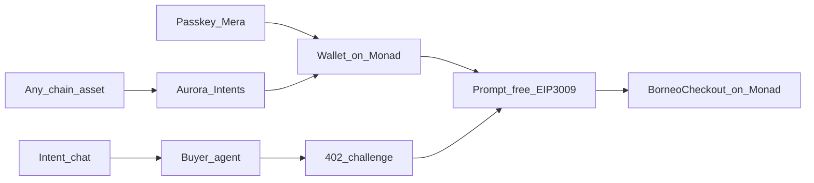

<div align="center">

# Borneo

[](#chains)
[](#passkey-accounts-mera)
[](#any-chain-top-ups-aurora-intents)
[](https://nextjs.org/)

**Shop with an AI agent, pay with a passkey. USDC settles on Monad, funded from any chain.**

Landing → [http://localhost:3000](http://localhost:3000) · Chains → [`docs/chains.md`](./docs/chains.md) · Monad setup → [`docs/monad.md`](./docs/monad.md) · Submission → [`docs/submission.md`](./docs/submission.md)

</div>

---

## The problem

More people are sending AI buyer agents to shop for them, but sellers aren't ready: most storefronts are built for humans, so agents scrape pages or give up, and merchants lose buyers they never see.

Paying is harder still for people who don't think of themselves as crypto users. They would need a wallet extension, a seed phrase, a gas token, and the right stablecoin on the right chain before an agent could spend a cent for them.

Borneo makes any online store readable by AI agents in seconds, and lets a shopper's agent pay in USDC on Monad with nothing but a passkey.

## Borneo @ Monad Metropolis

Track: **Consumer Products & Payments.** A shopper says what they want, the agent finds it across Borneo stores, and pays the store over HTTP 402 (x402) in USDC on Monad. The shopper never sees a seed phrase, an extension, a gas token or a bridge.



| Step | What happens | Built with |
|---|---|---|
| Sign up | One passkey ceremony creates the account. The passkey's PRF output derives the wallet key, so the same passkey rebuilds the same Monad address on any device | **Mera** |
| Shop | Salesperson agent searches stores and locks a quote (`storeSlug`, `skuId`, `price`, `merchant`) | Borneo agents |
| Fund | Short on USDC? Top up from Base, Arbitrum, Solana, Bitcoin and 25+ more chains. Aurora delivers USDC to the passkey wallet on Monad, and the order finishes on its own when it lands | **Aurora Intents** Swap API, **Alchemy** webhooks |
| Pay | The store answers `402`. The server checks the challenge, the browser signs the EIP-3009 authorization inside a scoped passkey session (no prompt), and the relayer settles through `BorneoCheckout` on Monad. The shopper needs no MON | **Mera** session, **Alchemy** RPC |
| Get paid | Merchants sign in with email and get a Privy embedded payout wallet, which signs the payout proof and withdraws USDC | **Privy** |

### Passkey accounts (Mera)

[`src/lib/mera/passkey-account.ts`](./src/lib/mera/passkey-account.ts) · [`passkey-wallet-provider.tsx`](./src/app/buyer/_components/passkey-wallet-provider.tsx) · [`session-scope.ts`](./src/lib/mera/session-scope.ts)

- **One-prompt onboarding.** `createPasskeyWithPrfOutput` → BIP-39/32 (`m/44'/60'/0'/0/0`) → `createSecp256k1SigningSession` → `toViemAccount`. No email, no OTP, no seed phrase, no extension, no custody backend.
- **Scoped prompt-free signing.** The session signs only EIP-3009 payment authorizations, only on known stablecoins and chains, up to $25 per payment (or the shopper's own lower governance limit) and $100 per session, for 30 minutes or until 10 idle minutes. Anything outside that, or after expiry, asks for the passkey again (step-up) before signing. The key copy is zeroed on lock, expiry and tab close.
- **Stateless test.** The only thing in localStorage is an untrusted hint (credential id + address) to pin the passkey. Clear it, or open a fresh device: the passkey rebuilds the same address.
- **The server never signs for the shopper.** `/api/buyer-agent` runs discovery and the capability checks (recomputes the order nonce, checks payTo, asset and amount against the locked quote) and returns the unsigned authorization. The browser signs it; `/api/buyer-agent/sign` verifies the signature and relays it.

### Any-chain top-ups (Aurora Intents)

[`src/lib/aurora/intents.ts`](./src/lib/aurora/intents.ts) · [`/buyer/fund`](./src/app/buyer/fund/page.tsx)

- When the passkey wallet is short, checkout links to `/buyer/fund` prefilled with the exact shortfall. The shopper picks what they hold (any chain and token Aurora lists), gets an `EXACT_OUTPUT` quote for that many USDC on Monad, and sends to a one-time deposit address.
- Refunds default to the passkey wallet itself on any EVM origin chain, since the same key controls the same address everywhere. Non-EVM origins ask for a refund address.
- The page polls `/api/status`, can report the deposit tx (`/api/deposit/submit`) to speed it up, and handles `INCOMPLETE_DEPOSIT`, `REFUNDED` and `FAILED`. On `SUCCESS` the shopper returns to the order and the agent **finishes the purchase automatically** with the funds that just arrived.
- The server fixes the destination (Circle USDC on Monad mainnet) and validates the recipient, so the proxy can only ever deliver USDC on Monad to an EVM address.

### Alchemy

- **RPC:** with `ALCHEMY_API_KEY` set, every server read, x402 settlement and relayer transaction on Monad (and Arbitrum/Base) goes through Alchemy's node endpoints ([`src/lib/alchemy/rpc.ts`](./src/lib/alchemy/rpc.ts)).
- **Webhooks:** when a shopper asks for a top-up, their wallet is added to an Address Activity webhook through the Notify API. `/api/alchemy/webhook` verifies `X-Alchemy-Signature` and records stablecoin arrivals, which the top-up page shows the moment Aurora's delivery lands ([`src/lib/alchemy/webhooks.ts`](./src/lib/alchemy/webhooks.ts)).

### Privy (merchants)

[`src/components/merchant/privy-payout-wallet.tsx`](./src/components/merchant/privy-payout-wallet.tsx) on `/merchant/setup`: email/Google/passkey sign-in creates a Privy embedded wallet, the wallet signs the payout-binding proof (`useSignMessage`), and the merchant withdraws received USDC with `useSendTransaction` (Privy gas sponsorship when enabled). Merchants no longer paste private keys into the page.

### Chains

| Chain | Testnet | Mainnet | Settle token | BorneoCheckout |
|---|---|---|---|---|
| **Monad** (primary) | `eip155:10143` | `eip155:143` | Circle USDC | Deploy with `--rpc-url monad_testnet` / `monad` ([`docs/monad.md`](./docs/monad.md)) |
| Arbitrum | `eip155:421614` | `eip155:42161` | USDC, Paxos USDG | Live on Arbitrum Sepolia |
| Base | `eip155:84532` | `eip155:8453` | USDC | Live on Base Sepolia |
| HyperEVM | `eip155:998` | `eip155:999` | USDC | Live on HyperEVM Testnet |

One codebase and one contract serve every chain. `CHAIN_NETWORK` picks the primary chain (Monad Testnet by default) and `SETTLE_NETWORKS` adds more, so a single 402 can offer several chains. Aurora Intents runs on mainnets, so the full any-chain top-up demo uses `CHAIN_NETWORK=eip155:143`.

| Step | Surface |
|---|---|
| Intent | `/buyer` salesperson + `GET /api/search` |
| Fund | `/buyer/fund` · `/api/aurora/{tokens,quote,status,submit}` |
| Buy (x402) | `POST /s/{slug}/buy` → **402** → passkey signs EIP-3009 → settle on Monad |
| Remember | `/buyer/activity` |
| Earn | `/buyer/xpoints` · invite `?ref=` boost |
| Skills | [`.agents/skills/borneo-registry-shop`](./.agents/skills/borneo-registry-shop/SKILL.md) |

**Do not scrape HTML.** Catalog prose never enters the pay path — settle only sees a locked quote (`storeSlug`, `skuId`, `price`, `merchantAddress`). XPoints are a rewards ledger driven by the protocol fee (not a token or security).

### How settlement works

1. `POST /s/{slug}/buy` without payment returns `402` with a `PAYMENT-REQUIRED` header. `accepts` holds one `exact` entry per settlement chain: network (`eip155:421614`, `eip155:84532`, ...), amount, asset (USDC or Paxos USDG), and `payTo` = that chain's **BorneoCheckout** contract. `extra` carries the merchant, the on-chain order key and the **order-bound nonce**, which differs per chain.
2. The buyer agent picks one entry and signs an EIP-3009 `ReceiveWithAuthorization` for exactly that amount, to the checkout, using that nonce.
3. Borneo's x402 facilitator verifies signature, balance, amount, time window and nonce off-chain, then relays `BorneoCheckout.settle(...)` (relayer pays gas, buyer needs no ETH).
4. The contract pulls the funds, pays the merchant `amount − fee`, sends the fee to the treasury, credits on-chain XPoints and emits `OrderSettled`. The receipt carries the chain, the explorer `txHash` link and the on-chain fee split.

An order settles once, on one chain. The server verifies against its own requirement for the chain the buyer signed for, never the buyer's copy, and holds the order until the paid record is stored. On a chain with no checkout address, Borneo falls back to a direct `TransferWithAuthorization` to the merchant.

## Smart contract: `BorneoCheckout`

[`contracts/src/BorneoCheckout.sol`](./contracts/src/BorneoCheckout.sol) is a non-custodial x402 settlement contract for agent payments (Foundry, OpenZeppelin v5, Solidity 0.8.24).

| Item | Details |
|---|---|
| Arbitrum Sepolia | [`0xf8188490C10d0248DBB27bD1A07F8a7b4f0e9fc4`](https://sepolia.arbiscan.io/address/0xf8188490C10d0248DBB27bD1A07F8a7b4f0e9fc4) · [verified on Arbiscan](https://sepolia.arbiscan.io/address/0xf8188490C10d0248DBB27bD1A07F8a7b4f0e9fc4#code) · [Blockscout](https://arbitrum-sepolia.blockscout.com/address/0xf8188490C10d0248DBB27bD1A07F8a7b4f0e9fc4?tab=contract) |
| Deploy tx | [`0xe1a2dec5…370f`](https://sepolia.arbiscan.io/tx/0xe1a2dec59a5af884e4eac74959f1795369472408fc80016f2d15f7ff41dd370f) |
| Settled purchase (USDC via checkout) | [`0x698479ad…3545`](https://sepolia.arbiscan.io/tx/0x698479add48aa055711965108a33457357465d4e36897029f96300757fa23545) — 0.02 USDC → 0.0199 merchant + 0.0001 treasury, 100 XPoints |
| Settled purchase (Paxos USDG via checkout, live site) | [`0x0ae5f616…0447`](https://sepolia.arbiscan.io/tx/0x0ae5f616ed692d6d3955c950a4ab8d73bb87a37162e876b8f654c52f897c0447) — 0.02 USDG → 0.0199 merchant + 0.0001 treasury |
| Allowlisted assets | Circle USDC, **Paxos USDG** |
| Base Sepolia | [`0x3aD9d36Fd382162E206415fF1736E78bF8326d28`](https://sepolia.basescan.org/address/0x3aD9d36Fd382162E206415fF1736E78bF8326d28) · deploy tx [`0x7b569afe…be76`](https://sepolia.basescan.org/tx/0x7b569afe3bf944e4dcd81b5d122e9323fdc4ec9c7f986b62d977b6942e4abe76) |
| Settled purchase (Base Sepolia, USDC via checkout) | [`0xe59a1358…f642`](https://sepolia.basescan.org/tx/0xe59a1358d09517132756e5a4be1ee623061d459611de348deae718bda6f8f642) — 0.02 USDC → 0.0199 merchant + 0.0001 treasury |
| HyperEVM Testnet | [`0x3aD9d36Fd382162E206415fF1736E78bF8326d28`](https://crypto-worlds-fair.vercel.app/explorer/998/address/0x3aD9d36Fd382162E206415fF1736E78bF8326d28) · deploy tx [`0x5bfd20c6…25c7`](https://crypto-worlds-fair.vercel.app/explorer/998/tx/0x5bfd20c64b7cb8041ad96f1b48c3910a72148eaac6ae35f4d45dba44a57225c7) (no public explorer indexes this testnet, so links go to Borneo's RPC-backed viewer) |
| Settled purchase (HyperEVM Testnet, USDC via checkout, live site) | [`0x524be5fa…38bb`](https://crypto-worlds-fair.vercel.app/explorer/998/tx/0x524be5fa8a4edcb79ff09a6ca1cab6ceda62dc4f9df71acd48e09e4a31da38bb) — 0.02 USDC → 0.0199 merchant + 0.0001 treasury |

**Why a contract instead of a plain transfer?** With `TransferWithAuthorization`, whoever holds the signature can submit it, and nothing on-chain ties the payment to an order. BorneoCheckout fixes that:

- **Order-bound nonce.** The EIP-3009 nonce must equal `keccak256(ORDER_TYPEHASH, chainId, checkout, orderId, merchant, token, amount)`. A relayer cannot redirect funds to another merchant, change amount or token, or reuse the signature for a different order. Changing any field breaks either the nonce check or the token's signature check.
- **No cross-chain replay.** `chainId` is part of the nonce and of the token's EIP-712 domain, so an authorization signed for Base cannot settle on Arbitrum or HyperEVM, even where the checkout has the same address.
- **Front-run safe.** `ReceiveWithAuthorization` can only be redeemed by the payee (the checkout), so the signature cannot be lifted from the mempool and replayed against the token directly.
- **Exactly-once orders.** Each `orderId` settles once (`OrderAlreadySettled`); token-level nonces stop replays across contracts.
- **On-chain fee split + XPoints.** `fee = amount × feeBps / 10 000` (hard cap 10%) goes to the treasury, the rest to the merchant in the same tx; the payer's `xpoints` accrue 1:1 with fee units. The contract never holds a balance after settlement; a balance-delta check guards against non-standard tokens.
- **Ops safety.** `Ownable2Step`, `Pausable`, `ReentrancyGuard`, `SafeERC20`, token allowlist, custom errors, `sweep` for stray tokens.

**Tests:** 29 Foundry tests including a 1 000-run fuzz (value conservation) against a mock EIP-3009 token, covering redirect, recomputed nonce, amount/token swap, random nonce, double settle, front-running, expiry, wrong payer, cross-chain replay, per-chain token allowlists, pause and admin paths, plus **fork tests that settle through the real Arbitrum Sepolia USDC and Paxos USDG contracts**. `npm test` adds offline tests for the chain registry, per-chain 402 entries and signatures, the passkey session scope and the Alchemy webhook.

```bash
cd contracts
forge test                                                      # unit + fuzz
forge test --match-contract Fork --fork-url https://sepolia-rollup.arbitrum.io/rpc   # real USDC + USDG
# Deploy to any chain alias in foundry.toml: arbitrum_sepolia, base_sepolia, hyperevm_testnet, ...
DEPLOYER_PRIVATE_KEY=0x… forge script script/DeployBorneoCheckout.s.sol --rpc-url base_sepolia --broadcast
```

End-to-end against a running server: `npx tsx --env-file=.env scripts/e2e-checkout.mts http://localhost:3000 atelier-tee "" base-sepolia` (the last argument picks the chain to pay on).

---

## Try it

```bash
npm install
cp .env.example .env
# Monad: deploy BorneoCheckout, fund the relayer with MON (docs/monad.md)
# Optional keys: AURORA_INTENTS_API_KEY, ALCHEMY_API_KEY, NEXT_PUBLIC_PRIVY_APP_ID
npm run chains:check   # preflight: RPC, token, EIP-712 domain, checkout, relayer gas
npm run dev            # passkeys need HTTPS or localhost
```

| Path | What it is |
|---|---|
| `/` | Landing — intent → route → settle → earn |
| `/buyer/login` | One-prompt passkey sign-in (Mera) |
| `/buyer` | Intent chat → passkey-signed USDC on Monad / Visa |
| `/buyer/fund` | Any-chain top-up (Aurora Intents) |
| `/buyer/activity` | Purchase ledger and reviews |
| `/buyer/xpoints` | XPoints balance and invite loop |
| `/merchant/setup` | Privy payout wallet, Visa receive, governance |
| `/merchant` · `/onboard` | Seller chat → publish agent storefront |
| `/dashboard` | Merchant orders |
| `/market` | Marketplace index |
| `/registry.json` | Network store index |
| `/demo` | Judge handshake script |

### Env (see [`.env.example`](.env.example))

| Var | Purpose |
|---|---|
| `CHAIN_NETWORK` | Primary chain. `eip155:10143` (Monad Testnet, default) or `eip155:143` (Monad). Arbitrum, Base and HyperEVM ids also work; labels such as `monad-testnet` too |
| `SETTLE_NETWORKS` | Extra chains on the same 402, comma-separated |
| `CHECKOUT_ADDRESS_<chainId>` | BorneoCheckout per chain, e.g. `CHECKOUT_ADDRESS_10143` |
| `FACILITATOR_PRIVATE_KEY` | Relayer that submits settlements. Needs MON on Monad |
| `BUYER_PRIVATE_KEY` | Server agent wallet, used only when `NEXT_PUBLIC_BUYER_ACCOUNTS=firebase` |
| `MERCHANT_ADDRESS` | Default merchant payTo (`0x…`) |
| `NEXT_PUBLIC_BUYER_ACCOUNTS` | `passkey` (default, Mera) or `firebase` (email sign-in + server agent wallet) |
| `AURORA_INTENTS_API_KEY` | Aurora Intents Swap API key (studio.aurora.dev) |
| `ALCHEMY_API_KEY` | Alchemy RPC for Monad, Arbitrum and Base |
| `ALCHEMY_WEBHOOK_SIGNING_KEY` · `ALCHEMY_WEBHOOK_ID` · `ALCHEMY_NOTIFY_TOKEN` | Address Activity webhook for top-up arrivals |
| `NEXT_PUBLIC_PRIVY_APP_ID` · `NEXT_PUBLIC_PRIVY_SPONSOR_GAS` | Privy merchant payout wallets |
| `OPENAI_API_KEY` | Agents + embeddings search |
| `NEXT_PUBLIC_FIREBASE_*` | Merchant auth and store sync |
| `PROTOCOL_FEE_BPS` · `TREASURY_ADDRESS` | Protocol fee (match the contract) and recipient |

### Contract / asset references

| Asset | Address |
|---|---|
| USDC (Monad Testnet) | `0x534b2f3A21130d7a60830c2Df862319e593943A3` |
| USDC (Monad) | [`0x754704Bc059F8C67012fEd69BC8A327a5aafb603`](https://monadscan.com/token/0x754704Bc059F8C67012fEd69BC8A327a5aafb603) |
| USDC (Arbitrum Sepolia) | [`0x75faf114eafb1BDbe2F0316DF893fd58CE46AA4d`](https://sepolia.arbiscan.io/token/0x75faf114eafb1BDbe2F0316DF893fd58CE46AA4d) |
| USDC (Arbitrum One) | [`0xaf88d065e77c8cC2239327C5EDb3A432268e5831`](https://arbiscan.io/token/0xaf88d065e77c8cC2239327C5EDb3A432268e5831) |
| USDC (Base Sepolia) | [`0x036CbD53842c5426634e7929541eC2318f3dCF7e`](https://sepolia.basescan.org/token/0x036CbD53842c5426634e7929541eC2318f3dCF7e) |
| USDC (Base) | [`0x833589fCD6eDb6E08f4c7C32D4f71b54bdA02913`](https://basescan.org/token/0x833589fCD6eDb6E08f4c7C32D4f71b54bdA02913) |
| USDC (HyperEVM Testnet) | `0x2B3370eE501B4a559b57D449569354196457D8Ab` |
| USDC (HyperEVM) | [`0xb88339CB7199b77E23DB6E890353E22632Ba630f`](https://hyperevmscan.io/token/0xb88339CB7199b77E23DB6E890353E22632Ba630f) |
| Paxos USDG (Arbitrum Sepolia) | [`0xFFC95faa3d63Cde504a05B567C600B78C0b41892`](https://sepolia.arbiscan.io/token/0xFFC95faa3d63Cde504a05B567C600B78C0b41892) |
| Paxos USDG (Arbitrum One) | [`0x004B506865409877C9fA29bfb1ebA929984B9bbC`](https://arbiscan.io/token/0x004B506865409877C9fA29bfb1ebA929984B9bbC) |
| BorneoCheckout (Arbitrum Sepolia) | [`0xf8188490C10d0248DBB27bD1A07F8a7b4f0e9fc4`](https://sepolia.arbiscan.io/address/0xf8188490C10d0248DBB27bD1A07F8a7b4f0e9fc4) |
| BorneoCheckout (Base Sepolia) | [`0x3aD9d36Fd382162E206415fF1736E78bF8326d28`](https://sepolia.basescan.org/address/0x3aD9d36Fd382162E206415fF1736E78bF8326d28) |
| BorneoCheckout (HyperEVM Testnet) | [`0x3aD9d36Fd382162E206415fF1736E78bF8326d28`](https://crypto-worlds-fair.vercel.app/explorer/998/address/0x3aD9d36Fd382162E206415fF1736E78bF8326d28) |
| Explorer (Monad Testnet) | `https://testnet.monadscan.com` |

### Scripts

| Command | Purpose |
|---|---|
| `npm run dev` | Local Next.js |
| `npm run build` / `npm start` | Production |
| `npm run lint` | ESLint |
| `npm test` | Offline multi-chain tests (no RPC needed) |
| `npm run chains:check` | Check each enabled chain against its live RPC before settling |

---

## Submission checklist (Monad Metropolis)

- [ ] Public repo + this README
- [ ] Live product link (HTTPS, so passkeys work)
- [ ] Technical demo video and pitch video
- [ ] BorneoCheckout deployed on Monad (testnet and/or mainnet) and `npm run chains:check` passing
- [ ] Settled passkey purchase on Monad with explorer link
- [ ] Live Aurora top-up: funds from another chain arrive and complete an order
- [ ] Prior work disclosed in the submission form
- [ ] Submit before Oct 14, 2026 11:59 GMT+8

See [`docs/submission.md`](./docs/submission.md) for the track and bounty write-ups.
