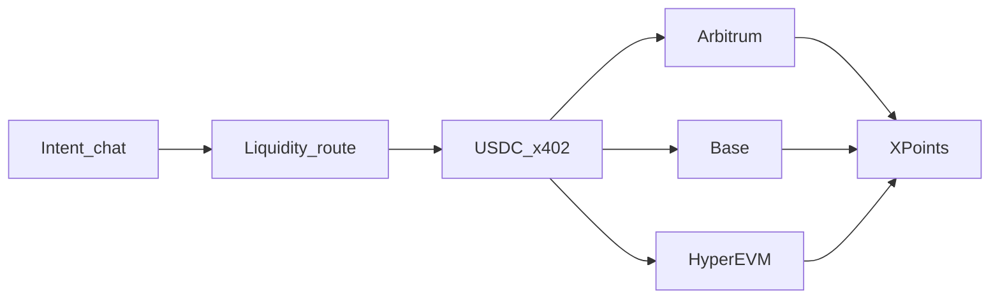

<div align="center">

# Borneo

[](#chains)
[](#chains)
[](#chains)
[](#borneo)
[](#borneo)
[](https://nextjs.org/)

**Intent → route → settle → earn. AI shopping agents that pay in USDC on Arbitrum, Base and HyperEVM.**

Landing → [http://localhost:3000](http://localhost:3000) · Chains → [`docs/chains.md`](./docs/chains.md) · Arbitrum setup → [`scripts/setup-arbitrum-usdc.md`](./scripts/setup-arbitrum-usdc.md)

</div>

---

## The problem

More people are sending AI buyer agents to shop for them, but sellers aren't ready: for every 10 buyer agents there is roughly 1 seller agent. Most storefronts are built for humans, so agents scrape pages or give up, and merchants lose buyers they never see.

Paying is just as hard. Users hold fragmented assets, so buying products, tokenized RWAs, or micro-payments usually means manual swaps and separate rails. Agent catalogs are often walled inside a few chat apps, and agents have no safe, open way to pay merchants.

Borneo makes any online store readable by AI agents in seconds, and lets agents pay safely in USDC on Arbitrum, Base and HyperEVM.

## Borneo @ Crypto World's Fair

**An AI-native shopping agent** takes natural-language intent, **routes liquidity** into USDC, **settles with x402**, and credits **XPoints** from a protocol micro-fee — so conversion is seamless *and* users earn rewards. Any HTTP agent can shop any Borneo store: the store answers `402 Payment Required` listing every chain it accepts, the agent signs a USDC authorization for one of them, and settlement lands on that chain in one round trip.



### Chains

| Chain | Testnet | Mainnet | Settle token | BorneoCheckout |
|---|---|---|---|---|
| Arbitrum | `eip155:421614` | `eip155:42161` | USDC, Paxos USDG | Live on Arbitrum Sepolia |
| Base | `eip155:84532` | `eip155:8453` | USDC | Live on Base Sepolia |
| HyperEVM | `eip155:998` | `eip155:999` | USDC | Live on HyperEVM Testnet |

One codebase and one contract serve all three. `CHAIN_NETWORK` picks the primary chain and `SETTLE_NETWORKS` adds more, so a single 402 can offer several chains and the buyer agent pays on the first one where its wallet holds enough. The Uniswap route quote and the ETH gas bridge are Arbitrum features and switch off elsewhere. Setup, deploy commands and what is and isn't verified: [`docs/chains.md`](./docs/chains.md).

| Step | Surface |
|---|---|
| Intent | `/buyer` salesperson + `GET /api/search` |
| Route | `GET/POST /api/liquidity` · Uniswap V3 quote (Arbitrum One) · outfit liquidity map |
| Buy (x402) | `POST /s/{slug}/buy` → **402** → sign EIP-3009 → settle on Arbitrum, Base or HyperEVM |
| Earn | `/buyer/xpoints` · invite `?ref=` boost |
| Outfit demo | `/s/atelier-tee` · `/s/harbor-caps` · `/s/stride-kicks` |
| RWA demo | `/s/arbitrum-rwa-desk` tokenized claim SKUs |
| Skills | [`.agents/skills/borneo-registry-shop`](./.agents/skills/borneo-registry-shop/SKILL.md) |

**Do not scrape HTML.** Catalog prose never enters the pay path — settle only sees a locked quote (`storeSlug`, `skuId`, `price`, `merchantAddress`). XPoints are a rewards ledger driven by the protocol fee (not a token or security).

### How settlement works

1. `POST /s/{slug}/buy` without payment returns `402` with a `PAYMENT-REQUIRED` header. `accepts` holds one `exact` entry per settlement chain: network (`eip155:421614`, `eip155:84532`, ...), amount, asset (USDC or Paxos USDG), and `payTo` = that chain's **BorneoCheckout** contract. `extra` carries the merchant, the on-chain order key and the **order-bound nonce**, which differs per chain.
2. The buyer agent picks one entry and signs an EIP-3009 `ReceiveWithAuthorization` for exactly that amount, to the checkout, using that nonce.
3. Borneo's x402 facilitator verifies signature, balance, amount, time window and nonce off-chain, then relays `BorneoCheckout.settle(...)` (relayer pays gas, buyer needs no ETH).
4. The contract pulls the funds, pays the merchant `amount − fee`, sends the fee to the treasury, credits on-chain XPoints and emits `OrderSettled`. The receipt carries the chain, the explorer `txHash` link and the on-chain fee split.

An order settles once, on one chain. The server verifies against its own requirement for the chain the buyer signed for, never the buyer's copy, and holds the order until the paid record is stored. On a chain with no checkout address, Borneo falls back to a direct `TransferWithAuthorization` to the merchant.

## Smart contract: `BorneoCheckout`

[`contracts/src/BorneoCheckout.sol`](./contracts/src/BorneoCheckout.sol) is a non-custodial x402 settlement contract for agent payments (Foundry, OpenZeppelin v5, Solidity 0.8.24).

| Item | Details |
|---|---|
| Arbitrum Sepolia | [`0xf8188490C10d0248DBB27bD1A07F8a7b4f0e9fc4`](https://sepolia.arbiscan.io/address/0xf8188490C10d0248DBB27bD1A07F8a7b4f0e9fc4) · [verified on Arbiscan](https://sepolia.arbiscan.io/address/0xf8188490C10d0248DBB27bD1A07F8a7b4f0e9fc4#code) · [Blockscout](https://arbitrum-sepolia.blockscout.com/address/0xf8188490C10d0248DBB27bD1A07F8a7b4f0e9fc4?tab=contract) |
| Deploy tx | [`0xe1a2dec5…370f`](https://sepolia.arbiscan.io/tx/0xe1a2dec59a5af884e4eac74959f1795369472408fc80016f2d15f7ff41dd370f) |
| Settled purchase (USDC via checkout) | [`0x698479ad…3545`](https://sepolia.arbiscan.io/tx/0x698479add48aa055711965108a33457357465d4e36897029f96300757fa23545) — 0.02 USDC → 0.0199 merchant + 0.0001 treasury, 100 XPoints |
| Settled purchase (Paxos USDG via checkout, live site) | [`0x0ae5f616…0447`](https://sepolia.arbiscan.io/tx/0x0ae5f616ed692d6d3955c950a4ab8d73bb87a37162e876b8f654c52f897c0447) — 0.02 USDG → 0.0199 merchant + 0.0001 treasury |
| Allowlisted assets | Circle USDC, **Paxos USDG** |
| Base Sepolia | [`0x3aD9d36Fd382162E206415fF1736E78bF8326d28`](https://sepolia.basescan.org/address/0x3aD9d36Fd382162E206415fF1736E78bF8326d28) · deploy tx [`0x7b569afe…be76`](https://sepolia.basescan.org/tx/0x7b569afe3bf944e4dcd81b5d122e9323fdc4ec9c7f986b62d977b6942e4abe76) |
| Settled purchase (Base Sepolia, USDC via checkout) | [`0xe59a1358…f642`](https://sepolia.basescan.org/tx/0xe59a1358d09517132756e5a4be1ee623061d459611de348deae718bda6f8f642) — 0.02 USDC → 0.0199 merchant + 0.0001 treasury |
| HyperEVM Testnet | [`0x3aD9d36Fd382162E206415fF1736E78bF8326d28`](https://crypto-worlds-fair.vercel.app/explorer/998/address/0x3aD9d36Fd382162E206415fF1736E78bF8326d28) · deploy tx [`0x5bfd20c6…25c7`](https://crypto-worlds-fair.vercel.app/explorer/998/tx/0x5bfd20c64b7cb8041ad96f1b48c3910a72148eaac6ae35f4d45dba44a57225c7) (no public explorer indexes this testnet, so links go to Borneo's RPC-backed viewer) |
| Settled purchase (HyperEVM Testnet, USDC via checkout, live site) | [`0x524be5fa…38bb`](https://crypto-worlds-fair.vercel.app/explorer/998/tx/0x524be5fa8a4edcb79ff09a6ca1cab6ceda62dc4f9df71acd48e09e4a31da38bb) — 0.02 USDC → 0.0199 merchant + 0.0001 treasury |

**Why a contract instead of a plain transfer?** With `TransferWithAuthorization`, whoever holds the signature can submit it, and nothing on-chain ties the payment to an order. BorneoCheckout fixes that:

- **Order-bound nonce.** The EIP-3009 nonce must equal `keccak256(ORDER_TYPEHASH, chainId, checkout, orderId, merchant, token, amount)`. A relayer cannot redirect funds to another merchant, change amount or token, or reuse the signature for a different order. Changing any field breaks either the nonce check or the token's signature check.
- **No cross-chain replay.** `chainId` is part of the nonce and of the token's EIP-712 domain, so an authorization signed for Base cannot settle on Arbitrum or HyperEVM, even where the checkout has the same address.
- **Front-run safe.** `ReceiveWithAuthorization` can only be redeemed by the payee (the checkout), so the signature cannot be lifted from the mempool and replayed against the token directly.
- **Exactly-once orders.** Each `orderId` settles once (`OrderAlreadySettled`); token-level nonces stop replays across contracts.
- **On-chain fee split + XPoints.** `fee = amount × feeBps / 10 000` (hard cap 10%) goes to the treasury, the rest to the merchant in the same tx; the payer's `xpoints` accrue 1:1 with fee units. The contract never holds a balance after settlement; a balance-delta check guards against non-standard tokens.
- **Ops safety.** `Ownable2Step`, `Pausable`, `ReentrancyGuard`, `SafeERC20`, token allowlist, custom errors, `sweep` for stray tokens.

**Tests:** 29 Foundry tests including a 1 000-run fuzz (value conservation) against a mock EIP-3009 token, covering redirect, recomputed nonce, amount/token swap, random nonce, double settle, front-running, expiry, wrong payer, cross-chain replay, per-chain token allowlists, pause and admin paths, plus **fork tests that settle through the real Arbitrum Sepolia USDC and Paxos USDG contracts**. `npm test` adds 14 offline tests for the chain registry, per-chain 402 entries and signatures.

```bash
cd contracts
forge test                                                      # unit + fuzz
forge test --match-contract Fork --fork-url https://sepolia-rollup.arbitrum.io/rpc   # real USDC + USDG
# Deploy to any chain alias in foundry.toml: arbitrum_sepolia, base_sepolia, hyperevm_testnet, ...
DEPLOYER_PRIVATE_KEY=0x… forge script script/DeployBorneoCheckout.s.sol --rpc-url base_sepolia --broadcast
```

End-to-end against a running server: `npx tsx --env-file=.env scripts/e2e-checkout.mts http://localhost:3000 atelier-tee "" base-sepolia` (the last argument picks the chain to pay on).

---

## Try it

```bash
npm install
cp .env.example .env
# Fill BUYER_PRIVATE_KEY, MERCHANT_ADDRESS, Firebase, OPENAI
# Fund the buyer with testnet USDC, and the relayer with a little gas, on each chain you enable
# See docs/chains.md (all chains) and scripts/setup-arbitrum-usdc.md (Arbitrum walkthrough)
npm run chains:check   # preflight: RPC, token, EIP-712 domain, checkout, relayer gas
npm run dev
```

| Path | What it is |
|---|---|
| `/` | Landing — intent → route → settle → earn |
| `/merchant` · `/onboard` | Seller chat → publish agent storefront |
| `/buyer` | Intent chat → route preview → USDC / Visa |
| `/buyer/xpoints` | XPoints balance + friend invite loop |
| `/market` | Marketplace index (fashion + RWA desk) |
| `/api/search?q=` | Intent search |
| `/api/liquidity?price=` | Liquidity route preview |
| `/registry.json` | Network store index |
| `/demo` | Judge handshake script |

### Env (see [`.env.example`](.env.example))

| Var | Purpose |
|---|---|
| `OPENAI_API_KEY` | Agents + embeddings search |
| `NEXT_PUBLIC_FIREBASE_*` | Buyer + merchant auth |
| `CHAIN_NETWORK` | Primary chain. `eip155:421614` (Arbitrum Sepolia, default), `eip155:42161`, `eip155:84532`, `eip155:8453` (Base), `eip155:998`, `eip155:999` (HyperEVM). Labels such as `base-sepolia` also work |
| `SETTLE_NETWORKS` | Extra chains to accept on the same 402, comma-separated, e.g. `base-sepolia,hyperevm-testnet` |
| `BUYER_NETWORK` | Chain the buyer agent prefers. Unset: first accepted chain where it holds enough |
| `BUYER_PRIVATE_KEY` | Server-side x402 signing |
| `FACILITATOR_PRIVATE_KEY` | Optional relayer for settlement gas (defaults to buyer key). Needs ETH on Arbitrum and Base, HYPE on HyperEVM |
| `MERCHANT_ADDRESS` | Default merchant payTo (`0x…`) |
| `CHECKOUT_ADDRESS_<chainId>` | BorneoCheckout on that chain, e.g. `CHECKOUT_ADDRESS_84532`. When set, x402 payments there settle through it. `CHECKOUT_ADDRESS` still works for the primary chain |
| `RPC_URL_<chainId>` | RPC override for a non-primary chain (`RPC_URL` for the primary) |
| `ALT_SETTLE_TOKEN` / `ALT_SETTLE_SYMBOL` | Second settle asset (defaults to Paxos USDG) |
| `PROTOCOL_FEE_BPS` | Fee in bps (default `50`); match the contract's `feeBps` |
| `TREASURY_ADDRESS` | Fee recipient (the checkout's `treasury`) |

### Contract / asset references

| Asset | Address |
|---|---|
| USDC (Arbitrum Sepolia) | [`0x75faf114eafb1BDbe2F0316DF893fd58CE46AA4d`](https://sepolia.arbiscan.io/token/0x75faf114eafb1BDbe2F0316DF893fd58CE46AA4d) |
| USDC (Arbitrum One) | [`0xaf88d065e77c8cC2239327C5EDb3A432268e5831`](https://arbiscan.io/token/0xaf88d065e77c8cC2239327C5EDb3A432268e5831) |
| USDC (Base Sepolia) | [`0x036CbD53842c5426634e7929541eC2318f3dCF7e`](https://sepolia.basescan.org/token/0x036CbD53842c5426634e7929541eC2318f3dCF7e) |
| USDC (Base) | [`0x833589fCD6eDb6E08f4c7C32D4f71b54bdA02913`](https://basescan.org/token/0x833589fCD6eDb6E08f4c7C32D4f71b54bdA02913) |
| USDC (HyperEVM Testnet) | `0x2B3370eE501B4a559b57D449569354196457D8Ab` |
| USDC (HyperEVM) | [`0xb88339CB7199b77E23DB6E890353E22632Ba630f`](https://hyperevmscan.io/token/0xb88339CB7199b77E23DB6E890353E22632Ba630f) |
| Paxos USDG (Arbitrum Sepolia) | [`0xFFC95faa3d63Cde504a05B567C600B78C0b41892`](https://sepolia.arbiscan.io/token/0xFFC95faa3d63Cde504a05B567C600B78C0b41892) |
| Paxos USDG (Arbitrum One) | [`0x004B506865409877C9fA29bfb1ebA929984B9bbC`](https://arbiscan.io/token/0x004B506865409877C9fA29bfb1ebA929984B9bbC) |
| BorneoCheckout (Arbitrum Sepolia) | [`0xf8188490C10d0248DBB27bD1A07F8a7b4f0e9fc4`](https://sepolia.arbiscan.io/address/0xf8188490C10d0248DBB27bD1A07F8a7b4f0e9fc4) |
| BorneoCheckout (Base Sepolia) | [`0x3aD9d36Fd382162E206415fF1736E78bF8326d28`](https://sepolia.basescan.org/address/0x3aD9d36Fd382162E206415fF1736E78bF8326d28) |
| BorneoCheckout (HyperEVM Testnet) | [`0x3aD9d36Fd382162E206415fF1736E78bF8326d28`](https://crypto-worlds-fair.vercel.app/explorer/998/address/0x3aD9d36Fd382162E206415fF1736E78bF8326d28) |
| Explorer | `https://sepolia.arbiscan.io` |

### Scripts

| Command | Purpose |
|---|---|
| `npm run dev` | Local Next.js |
| `npm run build` / `npm start` | Production |
| `npm run lint` | ESLint |
| `npm test` | Offline multi-chain tests (no RPC needed) |
| `npm run chains:check` | Check each enabled chain against its live RPC before settling |

---

## Submission checklist (Crypto World's Fair)

- [ ] Public repo + this README
- [ ] Live product URL
- [ ] Presentation video (2–3 min) and product demo video (up to 3 min): intent → route → settle USDC → earn XPoints, paying on more than one chain
- [x] Smart contract deployed on Arbitrum Sepolia, tested (unit + fuzz + fork) and verified
- [x] Arbiscan links for settled purchases (see Smart contract section)
- [x] BorneoCheckout deployed on Base Sepolia and HyperEVM Testnet; `npm run chains:check` passes on all three chains
- [x] Settled purchase on Base Sepolia and on HyperEVM Testnet
- [ ] Prior work disclosed in the submission form
- [ ] Submit before Oct 12, 2026 11:59pm PT

See [`docs/submission.md`](./docs/submission.md) for the track mapping and shot list.
